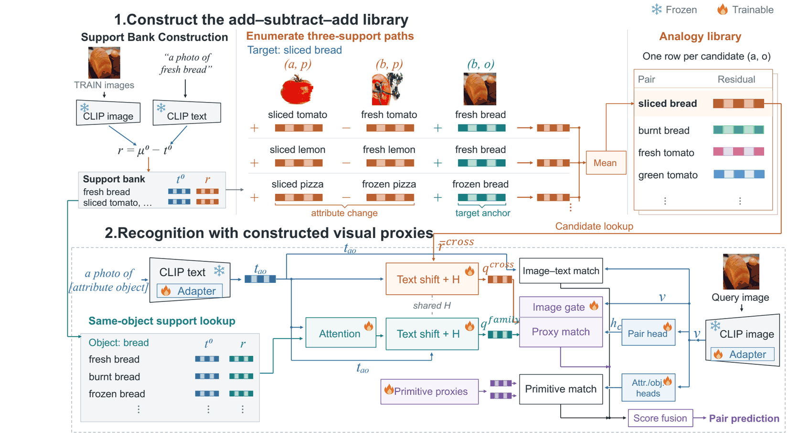

# Shift by Analogy for Compositional Zero-Shot Learning

**Zanwu Liu, Bo Li, Guanglin Niu**  
School of Artificial Intelligence, Beihang University, Beijing, China  
Correspondence: [Guanglin Niu](mailto:beihangngl@buaa.edu.cn)

How can a model recognize *sliced bread* when it has seen *fresh bread*, *fresh tomato*, and *sliced tomato*, but has never seen the target pair? Shift by Analogy (SBA) estimates the change from *fresh* to *sliced* on tomato and applies that change to the visual reference for bread.

## Method

For each seen attribute–object pair, SBA stores the displacement from its text embedding to the mean of its training image embeddings. Given a target attribute $a$ and object $o$, a source object $p$ and a reference attribute $b$ define an estimate of the missing displacement:

$$
\widetilde r_{ao}=r_{ap}-r_{bp}+r_{bo}.
$$

SBA averages valid estimates and shifts the target pair's text embedding to construct a visual proxy. A second proxy draws on seen states of the target object. An image-conditioned gate combines the two proxy scores, and the final prediction also uses text, attribute, and object scores. Each target is excluded from its own supports.

## Benchmark results

SBA with CLIP ViT-L/14. U denotes unseen accuracy and HM denotes the maximum harmonic mean of seen and unseen accuracy. All values are percentages.

| Dataset | Closed U | Closed HM | Closed AUC | Open U | Open HM | Open AUC |
| --- | ---: | ---: | ---: | ---: | ---: | ---: |
| C-GQA | 42.8 | 35.4 | 17.3 | 11.0 | 14.3 | 4.4 |
| MIT-States | 55.4 | 40.9 | 24.3 | 20.7 | 21.2 | 8.3 |
| UT-Zappos | 77.8 | 58.0 | 45.5 | 61.7 | 50.4 | 35.4 |

## Code

The training and evaluation code will be released in this repository.
